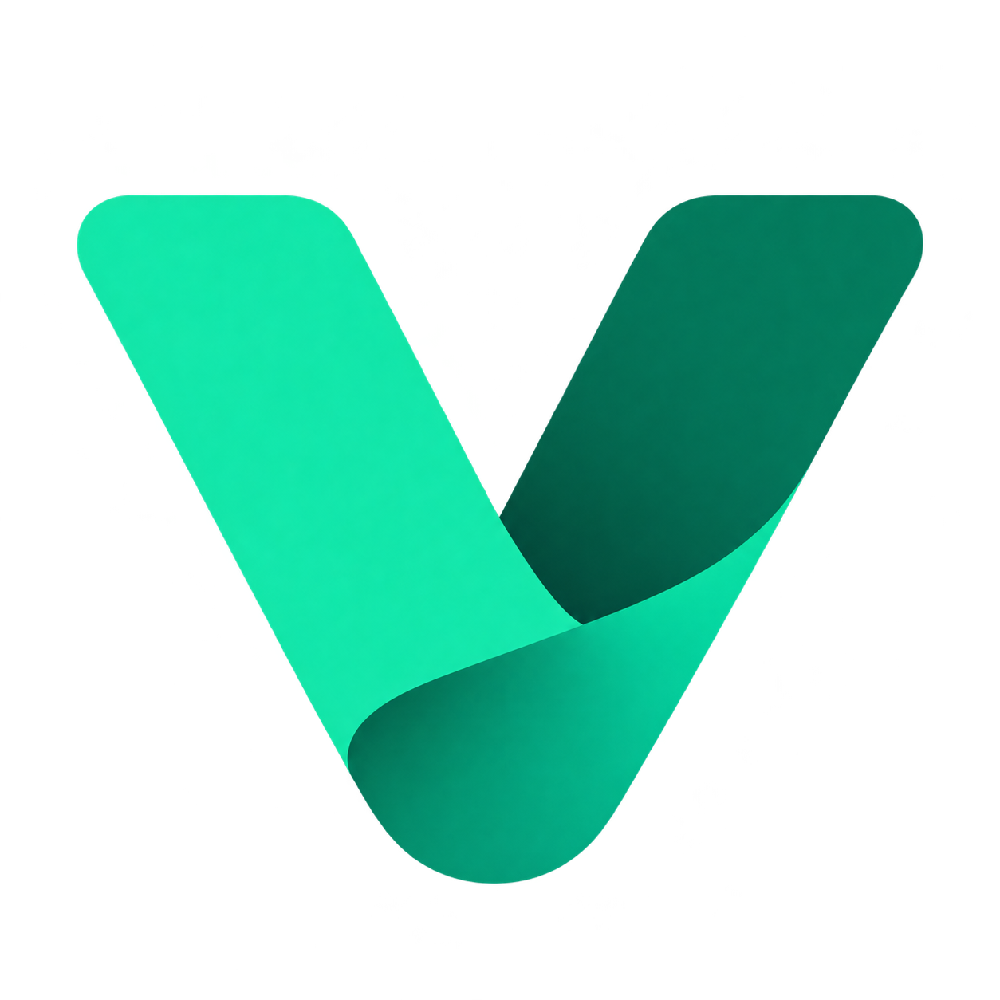
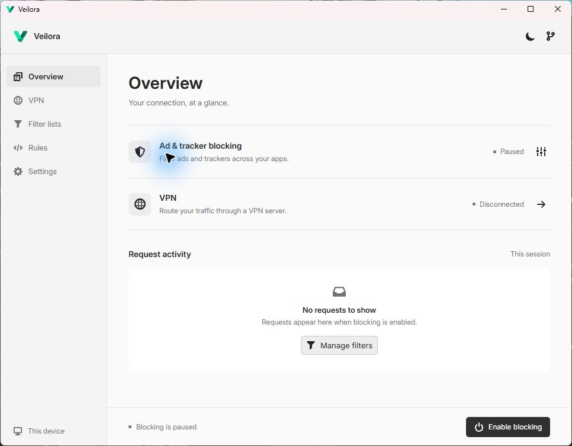

<p align="center"></p>
<h1 align="center">Veilora</h1>
<p align="center">Desktop ad blocking and VPN controls. Clear status, local configuration.</p>
<p align="center"><a href="#downloads">Downloads</a> · <a href="#getting-started">Get started</a> · <a href="docs/VALIDATION.md">Validation</a> · <a href="PRIVACY_POLICY.md">Privacy</a> · <a href="LICENSE">MIT license</a></p>

Veilora is a Go/Wails desktop application with a React interface, built on [Zen](https://github.com/irbis-sh/zen-desktop). It brings system-proxy filtering, request history, filter subscriptions, custom rules, and OpenVPN/SoftEther controls into one app.

## Downloads

Downloads are published automatically and links below update with the latest build. New commits pushed to `main` refresh the rolling release assets.

| Platform | Architecture | Download |
| --- | --- | --- |
| Windows | AMD64 installer | [Veilora-amd64-installer.exe](https://github.com/romitmeher/veilora/releases/latest/download/Veilora-amd64-installer.exe) |
| Windows | AMD64 portable | [Veilora_windows_amd64.zip](https://github.com/romitmeher/veilora/releases/latest/download/Veilora_windows_amd64.zip) |
| Windows | ARM64 portable | [Veilora_windows_arm64.zip](https://github.com/romitmeher/veilora/releases/latest/download/Veilora_windows_arm64.zip) |
| macOS | AMD64 DMG | [Veilora-amd64.dmg](https://github.com/romitmeher/veilora/releases/latest/download/Veilora-amd64.dmg) |
| macOS | ARM64 DMG | [Veilora-arm64.dmg](https://github.com/romitmeher/veilora/releases/latest/download/Veilora-arm64.dmg) |
| Linux | AMD64 | [Veilora_linux_amd64.tar.gz](https://github.com/romitmeher/veilora/releases/latest/download/Veilora_linux_amd64.tar.gz) |
| Linux | ARM64 | [Veilora_linux_arm64.tar.gz](https://github.com/romitmeher/veilora/releases/latest/download/Veilora_linux_arm64.tar.gz) |
| Android | APK | [Build an APK](.github/workflows/build-android.yml) |

GitHub [All releases](https://github.com/romitmeher/veilora/releases) contains versioned and rolling builds. Android is a separate Expo preview workflow and is not a native traffic-protecting VPN application; iOS builds are not currently produced. Windows and macOS signatures depend on repository signing credentials.

## Interface

<picture>
  <source media="(prefers-color-scheme: dark)" srcset="assets/screenshots/veilora-dark.png" />
  
</picture>

The desktop interface uses restrained light/dark surfaces, keyboard-accessible navigation, and [Torph](https://torph.lochie.me/) status transitions. Typography and interaction design draw on [Fluid Functionalism](https://www.fluidfunctionalism.com/). Reduced-motion preferences are respected.

## What works—and what is still a prototype

| Area | Implementation and validation |
| --- | --- |
| Desktop application | Windows executable builds and launches; overview, navigation, settings, and both themes inspected. |
| Ad blocking | Local HTTP/HTTPS proxy, filter subscriptions, custom rules, app routing, and request history are implemented. Live filtering has not been verified in this fork. |
| VPN | Standalone Windows builds include OpenVPN, its DLLs, and a signed TAP driver; no existing OpenVPN or SoftEther installation is needed. Administrator rights are required for adapter setup. SoftEther remains optional. The kill switch is unavailable; live connectivity and leak protection remain unverified. |
| Mobile | Expo UI prototype. Connections and blocking statistics are simulated; it does not protect device traffic. Type checking and web export pass. |
| Updates | Automatic updates are disabled to prevent this fork from installing upstream Zen releases. |

HTTPS filtering requires a locally generated root certificate. Read the [privacy notes](PRIVACY_POLICY.md) and [security notes](SECURITY.md) before enabling it. A successful build is not proof of working VPN protection.

## Getting started

Requirements:

- Go **1.26.1+**, as declared in [go.mod](go.mod).
- Node.js **24.14.1+** and npm.
- Wails **v2.11.0**, matching the Go dependency.
- Windows: WebView2. See [platform prerequisites](docs/internal/requirements.md) for other systems.
- Windows standalone builds: Visual Studio 2022 C++ tools, CMake, and Python 3 (build-time only).
- Optional: Go Task and golangci-lint v2 for the repository commands.

```powershell
go install github.com/wailsapp/wails/v2/cmd/wails@v2.11.0
cd frontend
npm ci
cd ..
wails dev
```

Build a Windows executable:

```powershell
git submodule update --init --recursive
powershell -NoProfile -File scripts/build-vpn-source.ps1 -Arch amd64
wails build -skipbindings -tags bundledvpn
# Output: build/bin/Veilora.exe
```

For the NSIS installer, use [build-installer.ps1](build-installer.ps1). Built executables are ignored by Git. Tagged and rolling builds are published by GitHub Actions.

See [bundled VPN details](docs/BUNDLED-VPN.md) for architecture selection, adapter behavior, upstream notices, and headless test limitations. Plain `wails dev` builds continue to use separately installed engines.

### Checks

```powershell
task lint
task test
task build-dev
```

Without Go Task:

```powershell
cd frontend
npm run build
npm run lint
cd ..
go test ./...
golangci-lint run
```

`task test` also enables Go's race detector and requires a supported C toolchain. Current checks and known lint findings are recorded in [VALIDATION.md](docs/VALIDATION.md).

### Mobile preview

```powershell
cd vpn-mobile
npm ci
npx expo start
# Static web build:
npx expo export --platform web
```

Android/iOS distribution requires separate Expo configuration and credentials. The mobile UI explicitly labels simulated protection.

## Repository map

| Path | Purpose |
| --- | --- |
| `main.go`, `internal/` | Native app, filtering, configuration, VPN engines and platform integration |
| `frontend/` | React desktop interface and Wails bindings |
| `vpn-mobile/` | Expo prototype |
| `assets/brand/` | Logo source and generation provenance |
| `scripts/export-brand.ps1` | Reproducible PNG/ICO exports from the logo source |
| `docs/` | Development notes and validation limits |

Veilora stores application data separately from Zen. Existing Zen settings are not automatically migrated. The upstream Go module path and filter-provider names remain for compatibility and attribution.

## Attribution and license

Veilora is a fork maintained in [romitmeher/veilora](https://github.com/romitmeher/veilora). Original Zen contributions and historical release notes remain credited. See [CHANGELOG.md](CHANGELOG.md), [LICENSE](LICENSE), and [COPYING.md](COPYING.md). This fork does not claim upstream signing, sponsorship, release infrastructure, or support guarantees.

## CI and release setup

Build and lint workflows track `main`. Windows artifacts are unsigned unless repository variable `SIGNPATH_ENABLED=true` and the fork's SignPath variables/token are configured. Signed macOS builds require `MACOS_SIGNING_ENABLED=true` and Apple credentials; the combined release job requires all platform builds. Android builds are manual local EAS builds on the runner and require Expo configuration and credentials. Release outputs remain drafts. Inherited updater-manifest and automated PR workflows are disabled for this fork.
